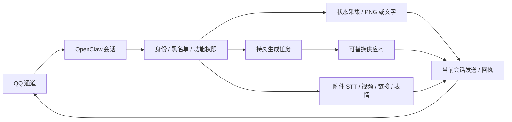

# 大肥鱼 OpenClaw QQ 伙伴

面向 **QQ 开放平台官方机器人** 和 **SnowLuma 私人 QQ 号** 两种接入方式的免费优先、按需启用开源项目。

> **早期 Alpha：提供实验性的管理员权限、云端模型和本机 ComfyUI 接入。2026-11-10 已在真实 SnowLuma + QQ 环境验证 `/fish` 指令收发，但模型回复、QQ 音频输入、媒体发送及视频生成仍未完成端到端验证；官方 QQBot 通道已按内建 `qqbot` 通道完成适配，尚未在真实机器人上跑通全链路。不建议作为稳定版使用。**

在 QQ 中发送 `/fish help` 或 `/fish` 可查看[已实现的指令](docs/commands.md)；具体能否调用仍由通道授权和功能权限决定。

## ⚠️ 装完却“用不了功能”？先看这里

本插件的 9 个工具都以 **可选工具**（`optional: true`）注册。OpenClaw 的规则是：**可选工具永远不会自动启用，必须显式加入工具允许列表，模型才看得见它们。**

只安装并启用插件、不配置这一步时，表现就是：`/fish image` 这类指令能用，但你跟机器人说“帮我画条鱼”，它完全不知道有生图能力。

补上这一行（推荐 `alsoAllow`，追加式，不会影响核心工具）：

```json5
{
  tools: { alsoAllow: ["fatfish"] }   // 该插件的全部工具；也可只写具体工具名
}
```

`openclaw fatfish setup` 会询问并自动写入。手动改配置后需重启 Gateway。

`0.1.0-alpha.16` 修复媒体并发缓存、重复链接和向导覆盖工具授权的问题。生图、视频、语音、表情包与解析媒体统一通过当前会话发送，返回通道回执；失败可用 `/fish resend 编号` 重发已有结果。运行 `openclaw fatfish doctor` 可检查配置和本机依赖，不调用计费模型。看视频技能默认在安装或主动更新时拉取 GitHub 最新版，支持 `rollback-video-skill` 回退。QQ 实际媒体收发仍待真实环境验证。

`0.1.0-alpha.17` 新增 [PNG 状态面板](docs/status-panel.md)、[持久生成任务与恢复查询](docs/tasks.md)、[标准语音/视频附件入口](docs/attachments.md)、[可选群聊策略](docs/chat-strategy.md)和按用户/群授权。管理员私聊 `/fish status` 查看模型、上下文、日/月观测用量、主机与功能状态；未知数据显示不可用。图片失败自动退回同权限文字。

## 功能状态

| 功能 | 状态 | 说明 |
|---|---|---|
| 接入通道 | 实验性 | 支持官方 QQBot（OpenClaw 内建 `qqbot`）与 [SnowLuma OneBot](docs/setup.md) 两种 |
| 配置向导 | 实验性 | [官方机器人](docs/qqbot.md) / [SnowLuma](docs/setup.md) |
| TTS / 音色克隆 | 实验性 | [MiMo 云端语音及克隆配置](docs/cloud-providers.md)，也可选 Edge TTS；默认关闭 |
| STT 语音识别 | 实验性 | 硅基流动供应商与[标准附件入口](docs/attachments.md)，需宿主提供媒体事实及 FFmpeg；私有 SILK 需通道转换 |
| 看视频 | 实验性 | [视频理解技能](docs/video-watch.md)：标准附件或 HTTPS 视频文件直链、抽帧和可选 STT |
| 媒体链接解析 | 实验性 | [解析平台链接并发送媒体](docs/media-parse.md)：依赖 yt-dlp，默认关闭，可用 `/fish parse on` 开启 |
| 生图 / 生视频 | 实验性 | [Agnes 云端模型](docs/cloud-providers.md)或[本机 ComfyUI](docs/comfyui.md)；视频服务曾返回繁忙，QQ 端到端未验证 |
| QQ 管理员 / 权限 | 实验性 | [配置 QQ 管理员与权限](docs/permissions.md)：SnowLuma 填 QQ 号，官方机器人填 openid（`/fish whoami` 查询） |
| QQ 黑名单 | 实验性 | [屏蔽用户和群](docs/blacklist.md)，标识同时接受 QQ 号与 openid |
| 表情包 | 实验性 | [导入和选用表情包](docs/stickers.md)；默认关闭，QQ 发送尚未实测 |
| 聊天人格 | 实验性 | [配置人格和说话风格](docs/persona.md)，支持管理员在 QQ 中调整 |
| 自然群聊策略 | 实验性 | [去重、短期观察、消息合并和限频](docs/chat-strategy.md)，默认关闭；上游需交付群消息和 @ 标记 |
| QQ 状态卡片 | 已实现，待实机验证 | [图片/文字面板](docs/status-panel.md)，原生/WASM 渲染，完整信息仅管理员私聊 |
| 生成任务队列 | 已实现，待实机验证 | [任务查询、取消、恢复和重发](docs/tasks.md)，Agnes 视频重启后只查询原任务 |

云端模型可能调整免费额度、限速和价格，请以服务商实时公告为准。Edge TTS 不需要本项目收取 API 费用，但使用的是在线服务，服务可能变化；本地模型也会产生设备和电力成本。模型文件须遵守各自许可，不会随本仓库发布。

## 前提

- 已安装 OpenClaw，版本需与插件 SDK 兼容；已用 OpenClaw 2026.6.35 和 Node.js 24.22.1 验证本地插件加载和模拟配置向导，并在 2026.11.2 的隔离 profile 下验证过插件加载（未接 QQ）。请参考 [OpenClaw 文档](https://docs.openclaw.ai/plugins/building-plugins)。
- **通道二选一**：
  - 官方机器人：在 [QQ 开放平台](https://q.qq.com) 创建机器人并拿到 AppID / AppSecret，OpenClaw 侧启用内建 `qqbot` 通道。见[官方机器人接入](docs/qqbot.md)。
  - SnowLuma：安装 SnowLuma 并扫码登录，启用社区通道 [openclaw-snowluma](https://github.com/t871631092/openclaw-snowluma)。见[配置向导教程](docs/setup.md)。
  - 本插件本身不连接 QQ，只消费 OpenClaw 通道传入的身份与会话。
- MiMo TTS 需要网络和 API 密钥；Edge TTS 需要 Python 和网络。参见[云模型教程](docs/cloud-providers.md)和 [Edge 语音教程](docs/tts.md)。
- 目前 OpenClaw 的通道、音频发送和安装兼容性尚未在真实环境全部验证。音频能否作为 QQ 语音发送取决于通道实现和媒体策略。

## 从 GitHub 安装（实验性）

OpenClaw 2026.6.35 下已验证以下 GitHub 安装及插件检查；请先审阅本仓库代码，只安装你信任的插件：

```bash
openclaw plugins install git:github.com/Bigesila-B/openclaw-fatfish@main
openclaw plugins enable fatfish
openclaw fatfish setup          # 选择“1 = 官方机器人”或“2 = SnowLuma”
```

非交互环境可能需要按 OpenClaw 提示在安装时添加 `--force`。`main` 会变化；生产环境建议改用审阅过的固定提交。

用 SnowLuma 时还可以让插件自动下载（官方仓库优先，不可用时回退到备用 fork，带 sha256 校验）：

```bash
openclaw fatfish install-snowluma
```

详见[官方机器人接入](docs/qqbot.md)、[配置向导教程](docs/setup.md)与[路线与验证记录](docs/ROADMAP.md)。

### 本地开发安装

先将仓库下载到运行 OpenClaw 的机器，然后在该目录执行：

```bash
npm ci --legacy-peer-deps --ignore-scripts
openclaw plugins install --link .
openclaw plugins enable fatfish
openclaw plugins inspect fatfish --runtime --json
```

本插件没有发布到 npm 或 ClawHub。向导会引导配置模型、QQ 通道和管理员，详见[配置向导教程](docs/setup.md)。真正的 QQ 登录、Gateway 收发及其他 OpenClaw 版本尚待验证；不要将以上步骤理解为经过端到端验证的一键安装。

参考 [云模型教程](docs/cloud-providers.md) 或 [Edge 语音教程](docs/tts.md) 启用可选工具。没有开启 TTS 时，插件不会调用语音服务。

## 路线与参与



请看 [架构与路线](docs/architecture.md) 和 [路线与验证记录](docs/ROADMAP.md)。运行 `npm test` 执行不依赖 QQ 或外部服务的测试。欢迎通过 GitHub 提交 Issue 或 Pull Request；不要提交真实 QQ 记录、访问令牌或服务商密钥。

本项目与 OpenClaw、SnowLuma、MaiBot、Microsoft、腾讯均无官方隶属关系。

代码采用 MIT 许可；随包字体的 OFL 1.1 许可、来源与构建记录位于 `assets/panel/`，渲染器遵循各自依赖许可。
